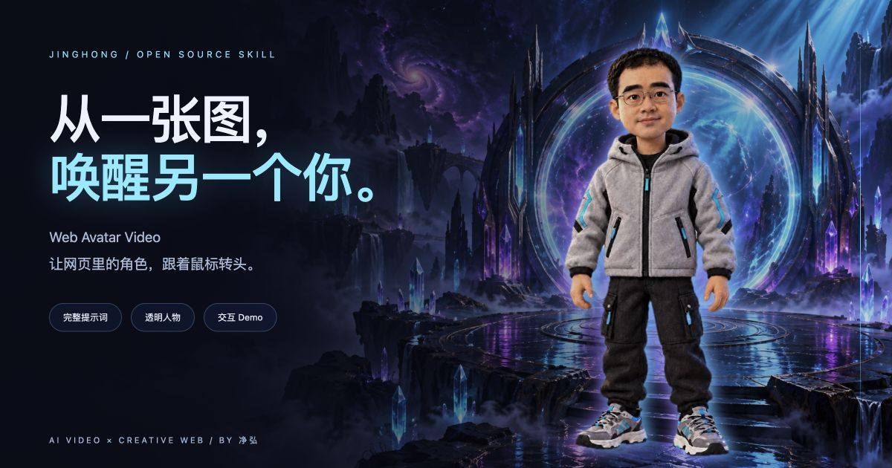

# Web Avatar Video

**一张角色图，一条环绕视频，一个能跟着鼠标转头的网页人物。**

由净弘（AIGCHONG）整理的网页交互人物 Skill，将角色图、AI 动作视频与网页交互串成一套完整流程。包含逐步教程、可直接复制的提示词、透明背景处理脚本，以及可独立运行的深色奇幻赛博风 Demo：鼠标控制角色转头方向，页面滚动控制指向、展示和挥手动作。

这是 **视频帧驱动的 2.5D 展示**，不是骨骼绑定的3D模型。适合个人网站、作品集和互动介绍页。

[在线 Demo](https://newdvn2025.github.io/web-avatar-video/assets/demo/) · [逐步教程](references/guide.md) · [完整提示词](references/prompts.md)

## 你可以做出什么

- 第一屏：角色看向上下左右与斜方向，鼠标离开窗口后回正。
- 后续章节：滚动驱动人物指向、展示、挥手，向上滚动可倒放。
- 透明人物融入厚涂风奇幻场景，搭配青色与紫色光束、粒子和霓虹轮廓。
- 原生 HTML / CSS / JavaScript，无需前端构建工具。

## 提示词工具箱

[打开全流程模板与变量表](references/prompts.md)。包含角色生成、服装九宫格、脸与眼睛调整、透明图、四类动作视频、视频验收、抠背景、方向校准、网页接入、背景生成、赛博动效、Hero封面与最终验收。

用 `{{变量名}}` 标出可调整项，附默认值与约束。可以直接让助手按你的需求填好整段，不用自己拼接句子。

## 五步制作

1. **定角色**：先确认衣服，再调整脸型和眼睛，定稿后每段视频都用同一张图。
2. **生成视频**：复制[环绕提示词](references/prompts.md)，先生成一条连续转头视频。直接描述眼球运动，不写容易被画成实体的“追踪目标”。
3. **验片与抠背景**：确认实际方向、脸型和多余物体，保留原尺寸生成透明 WebP 帧。
4. **校准时间**：按真实动作设置各方向对应的帧索引，不能直接套用示例参数。
5. **接入网页**：先运行独立 Demo，再把 Canvas、控制脚本和样式接入自己的页面。

想要滚动动作时，再分别生成指向、展示和挥手。无需一开始就生成全部素材。

## 运行 Demo

```sh
git clone https://github.com/Newdvn2025/web-avatar-video.git
cd web-avatar-video
python3 -m http.server 8091
```

打开 `http://localhost:8091/assets/demo/`。请通过 HTTP 运行，不直接双击 HTML。

## 安装 Skill

把本仓库目录复制到助手的 Skill 目录。例如 Codex：

```sh
git clone https://github.com/Newdvn2025/web-avatar-video.git ~/.codex/skills/web-avatar-video
```

已有同名目录时先检查内容，不覆盖。之后对助手说：

> 使用 $web-avatar-video，带我从角色图开始，一步一步制作网页交互人物。

本仓库根目录的 [SKILL.md](SKILL.md) 是技能入口，其余教程和脚本可按需读取。

## 自动处理视频

处理脚本目前适用于 **macOS 14+**，依赖 Swift、ffmpeg/ffprobe、Python 和 Pillow。Demo本身是普通静态网页，不限macOS。

```sh
python3 -m pip install Pillow
python3 scripts/prepare_frames.py /absolute/path/video.mp4 /absolute/path/output --fps 12
```

输出透明 WebP 与 manifest.json，非空输出目录拒绝覆盖。其他系统需要替换前景分割步骤；提供现成透明帧也可以使用Demo。

## 目录

```text
SKILL.md                    技能入口
references/guide.md         用户逐步教程
references/prompts.md       完整可复制提示词
references/implementation.md 参数、映射、排错与性能
scripts/prepare_frames.py   视频 → 透明 WebP
scripts/matte_video.swift   macOS Vision 前景分割
assets/demo/                可独立运行的赛博风示例
```

## 已知边界

环绕视频只提供一条姿态轨迹，无法精确注视任意空间点。示例按鼠标角度选帧，中心区回正，外圈距离不控制转头幅度。章节换片和中心过渡可能有跳变。原视频细节、分割边缘和12fps步进感需要实际检查。

完整示例素材约38MiB（另含背景图）；解码内存远高于下载体积。正式上线应使用限帧缓存、减少帧数或其他透明视频方案。现有CSS侧光是视觉模拟，不会重新计算人物真实表面光照。

移动端无鼠标悬停，第一屏静态，滚动动作可用。系统设置减少动态时人物静态，装饰动画停止。

## 授权

代码、脚本与文档采用 [MIT License](LICENSE)。`assets/` 与参考截图中的人物素材、生成图和示例帧不包含在MIT授权中：可查看运行本Demo；对外使用或再分发时，请替换为自己的授权素材，或联系作者获得授权。

作者：[净弘（AIGCHONG）](https://github.com/Newdvn2025)
